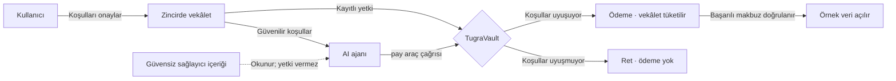

# Tuğra

**AI ajanları için tek işe özel, zincirde uygulanan ödeme yetkisi.**

Tuğra, bir ajanın kasadan **kime, tam olarak ne kadar, ne zamana kadar ve kaç kez** ödeme yapabileceğini belirler. Kullanıcı bu koşulları bir vekâletle onaylar; Monad üzerindeki `TugraVault` kontratı her ödemede koşulları uygular.

**Ajanına cüzdanını değil, tuğranı ver.**

[Canlı demo](https://tugra.onrender.com/?mandateId=3) · [Kontrat](https://testnet.monadscan.com/address/0xC2C75CDbc79e42e8897491FCe3a193EDEB795212) · [İşlem kanıtları](#zincir-kanıtları) · [Doğrulama kaydı](STATUS.md)

> **Demo kapsamı:** Kurgusal bir veri sağlayıcısına **0,01 test MON** ödenir; ödeme doğrulandıktan sonra örnek veri açılır. Yanlış alıcı ve tekrar ödeme senaryoları açıkça etiketlenmiş **kontrollü testlerdir**. Meşru ödeme gerçek bir AI modelinin araç çağrısıyla yapılmıştır.

## Problem

Bir ajan, rapor hazırlarken ücretli bir veri kaynağını okumak zorunda kalabilir. Aynı kaynak, ödeme adresinin değiştiğini söyleyen kötü niyetli bir talimat da içerebilir. Metni okuyabilmek, metnin istediği ödemeyi yapmaya yetkili olmak anlamına gelmemelidir.

Tuğra bu ayrımı ödeme anında uygular: **ajan çağrıyı önerir, kontrat önceden verilmiş yetkiyi kontrol eder.** Para kasada kalır; ajan anahtarı sınırlı yürütme yetkisine ve gas için test MON'a sahiptir.

## Nasıl çalışır?



1. **Vekâlet:** Kullanıcı yetkili ajanı, alıcıyı, tam tutarı ve son geçerlilik zamanını belirler. Vekâlet zincirde kesinleşir.
2. **Ajan:** Sunucu vekâleti doğruladıktan sonra sağlayıcı içeriğini modele verir. Model `pay(mandateId, payee, amount)` aracını çağırabilir.
3. **Kontrol:** Kontrat çağıranı ve vekâlet koşullarını denetler. Başarısız çağrı vekâleti tüketmez; başarılı ödeme tüketir.
4. **Erişim:** Sunucu başarılı makbuzu doğruladığında örnek veriyi açar. Reddedilen veya sonucu belirsiz bir deneme yeni veri erişimi açmaz.

Güvensiz içerik, **onaylanmış vekâletin koşullarını değiştiremez**. Model yine farklı bir ödeme isteyebilir; sunucu bu isteği sessizce doğru alıcı veya tutarla değiştirmez.

## Bir vekâletin sınırları

| Koşul | Kontratın uyguladığı sınır | Ret nedeni |
|---|---|---|
| Yetkili ajan | Yalnızca tanımlanan ajan çalıştırabilir | `NotAgent` |
| Sabit alıcı | Yalnızca onaylanan adrese ödeme | `PayeeMismatch` |
| Tam tutar | Üst limit değil, birebir eşleşme | `AmountMismatch` |
| Son geçerlilik | `block.timestamp <= expiry` | `Expired` |
| Tek kullanım | Başarılı ödemeden sonra tekrar kullanılamaz | `AlreadyUsed` |
| İptal | Sahip tarafından iptal edilen vekâlet kullanılamaz | `Revoked` |

Kontrat ayrıca reentrancy koruması uygular. Alıcıya transfer başarısız olursa işlem geri alınır; vekâlet kullanılmış sayılmaz.

## Zincir kanıtları

**Vekâlet #3**, public Render sunucusu ve Monad testnet üzerinde tamamlanan prova:

| Deneme | Kaynak | Doğrulanan sonuç |
|---|---|---|
| Yanlış alıcı | Kontrollü test; model çağrılmadı | [`PayeeMismatch` ile ret](https://testnet.monadscan.com/tx/0x55bd932bd66bc7d9cb2f0a11a93b260e6dead118c99d59ede034596f73593676); vekâlet kullanılabilir kaldı |
| Doğru ödeme | Gerçek `claude-haiku-5-5` araç çağrısı | [Ödeme başarılı](https://testnet.monadscan.com/tx/0xec3032dd36dab4f0895389791f8164d76e972b3de6a4040fa2f396d1105bfbfc); sağlayıcı +0,01 MON, veri erişimi açıldı |
| Aynı vekâletle tekrar | Kontrollü test; model çağrılmadı | [`AlreadyUsed` ile ret](https://testnet.monadscan.com/tx/0x8eaf93b4e2a8e34a2e99b03418e991081e40edeb9a7ddfe44e6c1392421afb60); ek ödeme olmadı |

[Vekâlet oluşturma işlemi](https://testnet.monadscan.com/tx/0x30ce0599dd7b1efb57055ebea450b13bbb64b93865328efc15653e80b6ee4209) yerel sahip hesabından gönderildi. Ödeme ve ret denemeleri public sunucu üzerinden yürütüldü.

Makbuzlar işlem durumunu, gerçek işlem trace'leri ise ret nedenlerini doğruladı: `0xe28e12ad` → `PayeeMismatch`, `0x7b8c8210` → `AlreadyUsed`. Saldırgan adresine ödeme gitmedi.

**Tek prova ölçümü:** Model yanıtı **1.378 ms**, meşru işlemin gönderiminden makbuzuna kadar bekleme **120 ms**. Bunlar ayrı ölçümlerdir; 120 ms bir ağ finality ölçümü veya performans garantisi değildir. Tam hash'ler, maliyetler ve doğrulama kapsamı [STATUS.md](STATUS.md) içindedir.

## Neden zincir? Neden Monad?

Burada zincir yalnızca ödeme taşımaz; **ödeme yetkisinin geçerli olup olmadığını belirler**. Alıcı, tutar, süre ve kullanım durumu kontratta tutulur. Sunucunun veya modelin değişmesi bu kayıtları ve kontrolleri ortadan kaldırmaz.

Sunucuyu veya ajan anahtarını kontrol eden taraf mevcut vekâletleri kullanabilir ve gas harcayabilir. Ancak `TugraVault` kasasından vekâlet koşulları dışında ödeme yaptıramaz. Bu sınır, kullanıcının doğru bir vekâlet onayladığı ve kontratın doğru çalıştığı varsayımına dayanır.

Monad'ın EVM uyumluluğu Solidity, Foundry ve viem ile aynı akışın kurulmasını sağlar. Gas limitine göre ücretlendirme, gönderim limitlerini açıkça belirlememizin nedenidir. Beklenen bir kontrat reddi zincirde gösterilecekse önce revert verisi çözülür; timeout veya çözülemeyen RPC hatasında işlem gönderilmez.

Tuğra'nın yalnızca Monad'da mümkün olduğunu veya sınırlı ödeme yetkisinin yeni bir kategori olduğunu iddia etmiyoruz.

## Uygulama

| Katman | Kullanılan yapı |
|---|---|
| Kasa ve yetki | Solidity · `TugraVault` · Foundry |
| Sunucu | Tek Node.js / Express süreci · viem |
| Ajan | Anthropic API · `claude-haiku-5-5` · tek `pay` aracı |
| Arayüz | Sunucudan servis edilen düz HTML, CSS ve JavaScript |
| Yayın | Render Web Service · Monad testnet · native test MON |

Gönderimler aynı ajan hesabı için sıraya alınır. Tutarlar wei cinsinden `BigInt` ile işlenir; model aracındaki MON tutarı ondalık metindir. Model ve zincir bekleme süreleri ayrı gösterilir.

## Demo erişimi ve sınırlar

- **İzlemek:** [Public demo](https://tugra.onrender.com/?mandateId=3) vekâlet #3'ü gösterir. Tamamlanan vekâlet kullanılmıştır; yeni canlı prova için yeni vekâlet gerekir. Geçmiş kayıtlar canlı çağrı gibi sunulmaz.
- **Çalıştırmak:** Model ve zincir işlemleri sunucuda operatör oturumu gerektirir. Token veya özel anahtar paylaşılmaz. Okuma uçları `/api/state` ve `/api/data` herkese açıktır.
- **Demo verisi:** Sağlayıcı kurgusaldır; açılan veriler örnektir. Ödemeler gerçek testnet işlemleridir ve test MON kullanır.
- **Telefon:** Sayfa telefondan açılır; seyircinin not göndereceği ayrı kuyruk uygulanmamıştır. Notu operatör girer.
- **Yeniden başlatma:** Oturumlar, geçmiş, kuyruk, bütçe sayaçları ve veri erişimi bellektedir. Süreç yeniden başladığında kaybolur; zincirdeki ödemeler ve vekâlet durumu kalır. Render ücretsiz servisi uykuya geçebilir.
- **Güven kapsamı:** Prompt injection'ın çözülmesi, modelin tüm davranışlarının güvenliği veya kullanıcının gerçek dünyadaki niyetinin anlaşılması garanti edilmez. Aynı satın alma için ayrı vekâletler oluşturulmasını bu sürüm engellemez.

## Yerelde çalıştırma

Node.js **22.x** gerekir. Kontrat geliştirme ve testleri için Foundry **1.8+** kullanılır.

```bash
git clone https://github.com/akifaybek/tugra.git
cd tugra
npm ci
```

İlk kurulumda `.env.example` dosyasından `.env` oluşturun. Mevcut bir `.env` dosyasının üzerine yazmayın. Değerleri yerelde doldurduktan sonra:

```bash
npm start
```

Varsayılan adres `http://localhost:3000`'dir. Belirli bir vekâleti açmak için `/?mandateId=3` gibi bir sorgu kullanın. `PORT` sunucu portunu, `MANDATE_ID` başlangıçta gösterilecek vekâleti belirler; URL'deki kimlik önceliklidir.

<details>
<summary><strong>Ortam değişkenleri ve operatör kurulumu</strong></summary>

Değerler depoya eklenmez. `.env` takip dışındadır.

| Değişken | Kullanım |
|---|---|
| `MONAD_RPC_URL` | Monad testnet RPC bağlantısı |
| `VAULT_ADDRESS` | Kullanılacak kasa kontratı |
| `AGENT_PRIVATE_KEY` | Gizli; vekâlette yetkilendirilmiş ajan hesabı |
| `ANTHROPIC_API_KEY` | Gizli; model API erişimi |
| `OPERATOR_TOKEN` | Gizli; operatör girişi, yoksa işlem yolları kapalı |
| `PROVIDER_ADDRESS` | Demo sağlayıcısının adres etiketi |
| `ATTACKER_ADDRESS` | Kontrollü yanlış alıcı testinin adresi |
| `MANDATE_ID` | Varsayılan vekâlet; URL sorgusu bunu değiştirebilir |

İsteğe bağlı sınırlar: `GAS_REVERT`, `FEE_CAP_WEI`, `PRIORITY_FEE_WEI`, `MAX_CHAIN_ATTEMPTS`, `MAX_TOTAL_GAS`.

`OWNER_PRIVATE_KEY` yalnızca yerel yönetim scriptleri içindir; üretim sunucusuna eklenmez. Sunucu vekâlet oluşturmaz veya kasayı fonlamaz. Kendi kurulumunuzda kendi kasanızı ve yetkilendirilmiş ajanınızı kullanın.

`script/preflight.sh` salt okunur hazırlık kontrolüdür. Cüzdan üretimi `script/make-wallets.sh`, kontrat ve prova adımları `script/proof-flow.sh` altında bulunur.

**`npm start` tek başına işlem göndermez. Operatörün model/ödeme eylemleri ve proof-flow gönderim adımları ücretli API kullanımı veya gerçek testnet işlemi başlatabilir.** Bunlar sıradan kurulum adımı olarak otomatik çalıştırılmaz.

</details>

## Testler ve kaynaklar

Kayıtlı son sonuçlar: **57 sunucu testi**, **52 kontrat testi**. Sahte bağımlılık testleri ile gerçek testnet provası ayrı doğrulama katmanlarıdır.

```bash
npm test
forge test
```

| Kaynak | İçerik |
|---|---|
| [src/TugraVault.sol](src/TugraVault.sol) | Kasa ve vekâlet kontrolleri |
| [test/](test/) | Kontrat testleri |
| [server/](server/) | Ajan, zincir adaptörü, operatör oturumu ve arayüz |
| [server/test/](server/test/) | Sunucu testleri |
| [script/](script/) | Yerel hazırlık, yönetim ve kanıt akışı |
| [STATUS.md](STATUS.md) | Geliştirme kaydı, ölçümler ve bilinen sınırlar |

**Ağ:** Monad testnet · chain ID `10143`  
**Kontrat:** `0xC2C75CDbc79e42e8897491FCe3a193EDEB795212`
