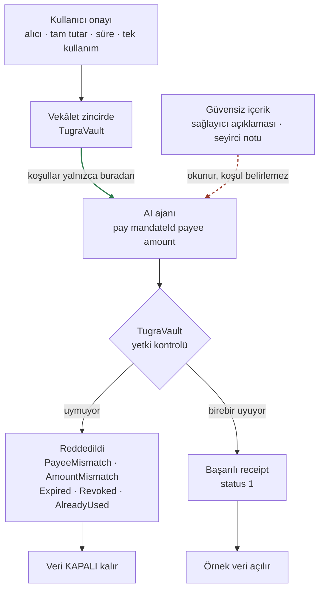

# Tuğra

**Ajanına cüzdanını değil, tuğranı ver.**

Bir AI ajanına ödeme yaptırmak için ona cüzdan vermek gerekmez. Tuğra'da
para kasada durur; ajanın elindeki tek şey, kullanıcının önceden
onayladığı **tek bir satın alma** için verilmiş bir vekâlettir.

| | |
| --- | --- |
| **Demo** | https://tugra.onrender.com/?mandateId=3 |
| **Kaynak kod** | bu depo |
| **Kontrat** | [`0xC2C75CDbc79e42e8897491FCe3a193EDEB795212`](https://testnet.monadscan.com/address/0xC2C75CDbc79e42e8897491FCe3a193EDEB795212) · Monad Testnet, chainId `10143` |

**Demo 30 saniyede:** Kullanıcı bir vekâlet onaylar — alıcı, tam tutar,
süre, tek kullanım. Ajan bir sağlayıcı açıklaması ve bir seyirci notu
okur; bu içerik güvenilmezdir. Ajan ödeme çağrısı üretir. Kontrat çağrıyı
vekâletle karşılaştırır: uymuyorsa zincirde reddeder, uyuyorsa ödeme geçer
ve örnek veri açılır. Üçü de gerçek Monad testnet işlemi olarak
kanıtlanmıştır — [aşağıdaki tabloda](#kanıtlar).

> Tuğrasız belge geçmez; tuğra sadece belgede yazanı onaylar.

---

## Akış



Yeşil kenar güvenilir kaynağı gösterir: ajan, alıcı, tutar ve süre
**yalnızca zincirdeki vekâletten** gelir. Kesikli kırmızı kenar güvensiz
içeriktir — ajan onu okur ama ondan hiçbir ödeme parametresi türetilmez.
Ret yolu veriyi açmaz.

## Vekâletin sınırları

Vekâlet dört şeyi aynı anda sabitler:

| Sınır | Anlamı | İhlalde |
| --- | --- | --- |
| **Sabit alıcı** | Ödeme yalnızca vekâlette yazan adrese gider | `PayeeMismatch` |
| **Tam tutar** | Birebir eşleşir; eksik, fazla ve sıfır reddedilir | `AmountMismatch` |
| **Süre** | `block.timestamp <= expiry` ise geçerli | `Expired` |
| **Tek kullanım** | Başarılı ödemeden sonra tükenir | `AlreadyUsed` |

Ek olarak: sahip vekâleti iptal edebilir (`Revoked`), yetkisiz çağıran
reddedilir (`NotAgent`), başarısız deneme vekâleti **tüketmez**, reentrancy
koruması vardır.

Ajanın kasadan para çıkarabileceği tek yol `execute(mandateId, payee, amount)`.
Approval, keyfi çağrı veya upgrade yok.

## Kanıtlar

Vekâlet **#3** ile, **public sunucu** üzerinden yapılmış gerçek Monad
testnet işlemleri:

| Deneme | Kaynak | Beklenen | Gerçekleşen | Explorer |
| --- | --- | --- | --- | --- |
| Yanlış alıcıya ödeme | Kontrollü test — **model kararı değil** | Ret | `status 0`, trace `0xe28e12ad` = `PayeeMismatch`, vekâlet tükenmedi | [`0x55bd932b…593676`](https://testnet.monadscan.com/tx/0x55bd932bd66bc7d9cb2f0a11a93b260e6dead118c99d59ede034596f73593676) |
| Meşru ödeme | **Gerçek model çağrısı** (`claude-haiku-5-5`) | Başarı | `status 1`, alıcı +0,01 MON, vekâlet tükendi, veri açıldı | [`0xec3032dd…5bfbfc`](https://testnet.monadscan.com/tx/0xec3032dd36dab4f0895389791f8164d76e972b3de6a4040fa2f396d1105bfbfc) |
| Aynı vekâletle tekrar | Kontrollü test — **model kararı değil** | Ret | `status 0`, trace `0x7b8c8210` = `AlreadyUsed`, ek ödeme yok | [`0x8eaf93b4…1afb60`](https://testnet.monadscan.com/tx/0x8eaf93b4e2a8e34a2e99b03418e991081e40edeb9a7ddfe44e6c1392421afb60) |

Vekâlet #3'ü oluşturan işlem (sahip anahtarıyla, yerelde):
[`0x30ce0599…ee4209`](https://testnet.monadscan.com/tx/0x30ce0599dd7b1efb57055ebea450b13bbb64b93865328efc15653e80b6ee4209)

Kontrollü testlerde model **çağrılmaz**; çağrı operatör tarafından elle
üretilir ve ekranda ayrı etiketlenir. Meşru ödemede model `pay` aracını
vekâletteki doğru alıcıyla çağırdı. Saldırgan adresi akış boyunca hiç MON
almadı. Ölçülen süreler ayrı tutulur: model 1.378 ms, işlem gönderiminden
makbuza 120 ms.

## On-chain necessity

Yetkiyi uygulayan prompt değil, kontrat. Model farklı bir alıcı veya tutar
isterse sunucu bunu **sessizce düzeltmez** ve engellemez: çağrı olduğu gibi
`TugraVault.execute`'a gider ve reddi kontrat verir. Reddin kanıtı
makbuzda ve trace'te durur, sunucunun kendi raporunda değil.

Bu, sunucu tarafı bir kontrolle elde edilemez: sunucu ele geçirilse veya
kodu değiştirilse bile ajan anahtarı kasadan vekâlet kapsamı dışında para
çıkaramaz, çünkü kontrol zincirdedir ve ajanın tek çıkış yolu `execute`'tur.

Monad'ın iki pratik etkisi tasarıma yansıdı:

- **Ücret gas limitine göre kesilir**, kullanılan gas'a göre değil
  (`gas_paid = gas_limit × price_per_gas`). Bu yüzden gas limitleri
  ölçülerek belirlendi.
- **Revert edecek işlemde `estimateGas` hata verir.** Demo'nun kanıtı tam
  olarak o revert olduğundan, sabit limitle gönderim yalnızca revert
  verisi ABI ile çözülüp beklenen kontrat hatası doğrulandığında yapılır.
  Timeout, bağlantı hatası, rate limit veya yetersiz bakiyede işlem
  **gönderilmez**, belirsizlik olarak raporlanır.

Monad'a özgü bir hız veya benzersizlik iddiamız yok; yukarıdaki 120 ms
makbuz bekleme süresidir, finality değildir.

## Mimari

```
TugraVault (Solidity)           Monad testnet, native MON
  ├── sahip: deposit / withdraw / createMandate / revoke
  └── ajan : execute(mandateId, payee, amount)    ← tek çıkış yolu

Tek Node.js süreci (Express)
  ├── güven sınırı: vekâlet zincirden doğrulanmadan güvensiz not
  │   modele verilmez
  ├── model: claude-haiku-5-5, tek araç pay(mandateId, payee, amount)
  ├── seri gönderim kuyruğu (ajan hesabında nonce çakışmasını önler)
  └── düz HTML/JS ekran (derleme adımı yok)
```

Ödeme ancak makbuz `status: success` ile doğrulandıktan sonra başarılı
sayılır ve örnek veri açılır.

## Kurulum

Gerekenler: Node 22, Foundry 1.8+.

```bash
npm ci
cp .env.example .env        # değerleri siz doldurun
./script/make-wallets.sh    # cüzdanları üretir, anahtarı ekrana basmaz
npm start                   # PORT üzerinden 0.0.0.0 dinler
```

```bash
npm test      # sunucu: 57 test
forge test    # kontrat: 52 test
```

Salt okunur hazırlık kontrolü: `./script/preflight.sh` — işlem göndermez.

> **Zincire işlem gönderen adımlar kurulumun parçası değildir.**
> Deploy, kasaya fon yatırma, vekâlet oluşturma ve ödeme denemeleri
> `script/proof-flow.sh` ile tek tek yapılır; her adım ayrı onay ister ve
> gerçek test MON harcar. Sunucu sahip anahtarını okumaz, bu yüzden kendi
> başına vekâlet oluşturamaz veya kasaya fon yatıramaz.

## Ortam değişkenleri

Yalnızca adlar. Değerler depoya girmez; `.env` `.gitignore` içindedir.

| Ad | Gizli | Not |
| --- | --- | --- |
| `MONAD_RPC_URL` | hayır | zorunlu |
| `VAULT_ADDRESS` | hayır | zorunlu |
| `AGENT_PRIVATE_KEY` | **evet** | zorunlu |
| `ANTHROPIC_API_KEY` | **evet** | zorunlu |
| `OPERATOR_TOKEN` | **evet** | yoksa model ve zincir yolları `503` |
| `ATTACKER_ADDRESS` | hayır | yoksa kontrollü test kullanılamaz |
| `PROVIDER_ADDRESS` | hayır | yoksa alıcı adı görünmez |
| `MANDATE_ID` | hayır | yoksa ekran `?mandateId=…` bekler |

İsteğe bağlı: `PORT`, `GAS_REVERT`, `FEE_CAP_WEI`, `PRIORITY_FEE_WEI`,
`MAX_CHAIN_ATTEMPTS`, `MAX_TOTAL_GAS`.

`OWNER_PRIVATE_KEY` yalnızca yerel scriptler içindir ve üretim sunucusuna
konmaz; sunucu kodu bu değişkeni okumaz.

## Sınırlamalar

- Sağlayıcı kurgusal, gerçek marka yok; açılan örnek veri uydurmadır.
- Ödeme Monad testnet'te native test MON ile yapılır. Gerçek para yok.
- **Telefon not kuyruğu uygulanmadı.** Güvensiz not şu an operatör
  tarafından ekrandan girilir ve kaynağı "operatör notu" olarak belirtilir.
- **Kalıcı veri yok.** Deneme geçmişi, sayaçlar, gönderim kuyruğu, gas
  bütçesi, operatör oturumu ve açılmış veri erişimi bellekte tutulur;
  sunucu yeniden başladığında sıfırlanır. Kalıcı olan tek şey zincirdeki
  durumdur — ödeme zincirde kalır ama ekran yeniden kilitlenir.
- **Demo işlemleri operatör girişi gerektirir.** Model çağrısı veya zincir
  işlemi başlatan bütün yollar sunucuda oturum ister; oturumsuz istek
  model ve zincire hiç dokunmadan `401` döner. `/api/state` ve `/api/data`
  okuma uçları açıktır.

### Ne iddia etmiyoruz

Prompt injection'ı çözdüğümüzü, mekanizmanın benzersiz olduğunu veya
yalnızca Monad'da mümkün olduğunu söylemiyoruz. Modelin her davranışının
güvenli olduğunu da söylemiyoruz — güvence yalnızca kasa varlıkları ve
verilen vekâletin kapsamıyla sınırlıdır. Kontratın vekâlet içindeki her
hatayı veya yanlış kullanıcı niyetini anlayabildiğini de iddia etmiyoruz.

## Depo düzeni

```
src/TugraVault.sol    kontrat
test/                 Foundry testleri (52)
script/               deploy ve kanıt akışı scriptleri
server/               tek Node süreci + düz HTML/JS ekran
server/test/          sunucu testleri (57)
STATUS.md             çalışma kaydı, ölçümler, doğrulanmamış noktalar
```

## Lisans

MIT
